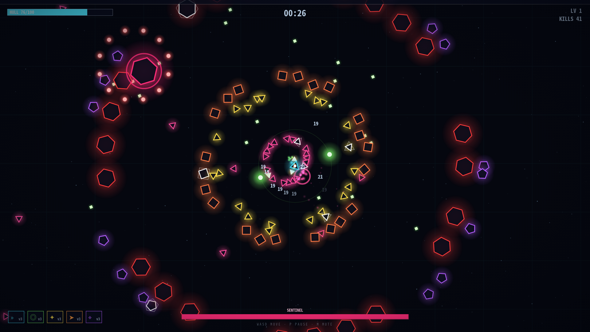

# NEON SWARM

One ship. An endless swarm. A zero-asset survivors-like — every sprite,
sound and track is generated in code.



## Play

```bash
npm install
npm run dev        # open the printed URL
```

- **WASD / arrows** — move
- **1 / 2 / 3** — pick an upgrade on level-up
- **P / Esc** — pause · **M** — mute

Survive the scaling swarm, level up, stack weapon systems
(Pulse Blaster / Gyre Blades / Nova Burst / Seeker Swarm / Rail Lance,
each Mk.I–V) and modules. Bosses at 95 s and 230 s.

## Engineering notes

- Fixed-step sim (60 Hz) decoupled from rAF; entities in object pools,
  collisions via a rebuilt-per-tick spatial hash.
- Deterministic: `new Game(seed)` — the whole run is a function of the
  seed. `tests/balance.test.ts` plays it headlessly with a kiting bot.
- Audio is synthesized: WebAudio SFX + a 132 BPM A-minor sequencer whose
  intensity follows the difficulty curve.
- `promo/` contains a 20 s launch film built with
  [HyperFrames](https://hyperframes.heygen.com); the BGM is the game's
  own sequencer rendered offline (`scripts/render-music.mjs`), and the
  footage is real in-engine frames staged by `scripts/stage-shot.mjs`.
